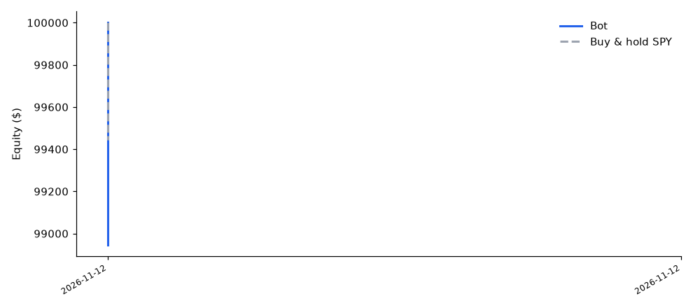

# Paper Trader Scorecard

_Simulated money only. Updated automatically after each trading day. Live view: the dashboard link in the README._

Since 2026-11-12 - 1 trading day(s)

**Trailing buy-and-hold SPY by 0.50 points.** Only 1 trading day(s) so far - too early to judge (wait for 20+).

| | Bot | Buy & hold SPY |
|---|---|---|
| Return | -1.06% | -0.56% |
| Equity | $98,944.66 | $99,442.81 |

## Stats

| Metric | Value |
|---|---|
| Total P&L | -$1,055.34 |
| Trades | 6 |
| Win rate | 17% |
| Avg win / avg loss | $72.53 / -$225.57 |
| Profit factor | 0.06 |
| Max drawdown | -1.06% |
| Best / worst day | -$1,055.34 / -$1,055.34 |
| Green days | 0 of 1 |
| Longs | 5 trades, -$1,127.87 |
| Shorts | 1 trades, $72.53 |

## Is the AI news filter helping?

The AI blocked 3 trade(s) the rules wanted. Simulated outcome of those trades: -$365.45 -> the filter has **saved $365.45**.

## Recent days

| Date | P&L | Bot % | SPY % | Trades | AI blocked |
|---|---|---|---|---|---|
| 2026-11-12 | -$1,055.34 | -1.05% | +0.37% | 6 | 3 |

## Recent trades

| Date | Symbol | Side | Qty | Entry | Exit | P&L |
|---|---|---|---|---|---|---|
| 2026-11-12 | NKE | short | 524 | 37.95 | 37.81 | $72.53 |
| 2026-11-12 | TQQQ | long | 234 | 60.87 | 59.72 | -$269.10 |
| 2026-11-12 | ARKK | long | 258 | 77.23 | 76.47 | -$194.94 |
| 2026-11-12 | HOOD | long | 239 | 83.73 | 81.79 | -$463.65 |
| 2026-11-12 | MSFT | long | 37 | 528.25 | 525.25 | -$111.00 |
| 2026-11-12 | QQQ | long | 28 | 690.73 | 687.54 | -$89.18 |
