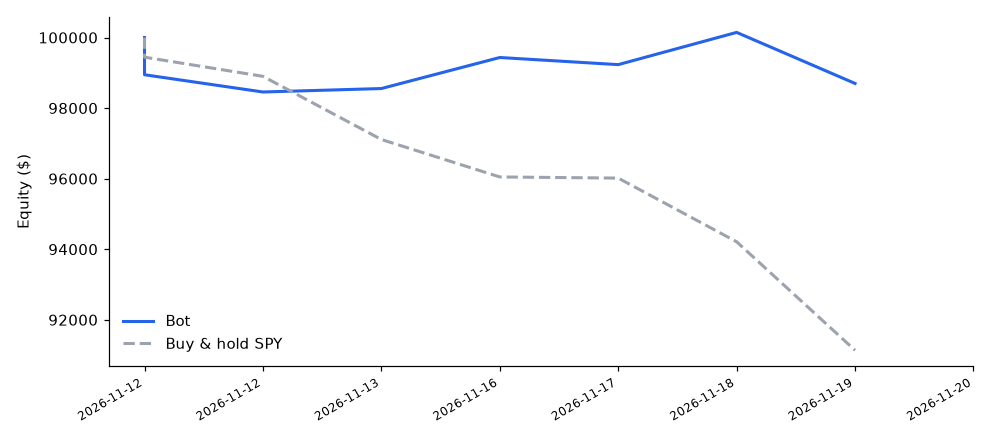

# Paper Trader Scorecard

_Simulated money only. Updated automatically after each trading day. Live view: the dashboard link in the README._

Since 2026-11-12 - 4 trading day(s)

**Beating buy-and-hold SPY by 3.38 points.** Only 4 trading day(s) so far - too early to judge (wait for 20+).

| | Bot | Buy & hold SPY |
|---|---|---|
| Return | -0.57% | -3.95% |
| Equity | $99,433.35 | $96,048.41 |

## Stats

| Metric | Value |
|---|---|
| Total P&L | -$566.65 |
| P&L after est. slippage (3 bps/side, what real money might see) | -$880.45 (-0.88%) |
| Trades | 27 |
| Win rate | 22% |
| Avg win / avg loss | $387.03 / -$137.20 |
| Profit factor | 0.81 |
| Max drawdown | -1.54% |
| Best / worst day | $882.79 / -$1,055.34 |
| Green days | 2 of 4 |
| Longs | 12 trades, -$1,838.70 |
| Shorts | 15 trades, $1,279.64 |

## Is the AI news filter helping?

The AI blocked 8 trade(s) the rules wanted. Simulated outcome of those trades: -$48.38 -> the filter has **saved $48.38**.

## Small-cap experiment ($5-$10 stocks: tracked, not traded)

Real bid-ask spread at signal time, main list: median **0.040%** over 57 signals (the backtest assumed 0.06% round trip).
Real spread, small caps: median **0.714%**.

| | Signals | Avg R before costs | Avg R after the spread | Won (after spread) |
|---|---|---|---|---|
| $5-$10 stocks | 2 | +3.298 | +2.876 | 1/2 |

R = profit as a multiple of the risk to the stop. Positive after the spread over 50+ signals would justify trading this tier; until then it's just watched.

## Recent days

| Date | P&L | Bot % | SPY % | Trades | AI blocked |
|---|---|---|---|---|---|
| 2026-11-17 | $882.79 | +0.90% | -1.03% | 8 | 0 |
| 2026-11-16 | $100.00 | +0.10% | -1.43% | 8 | 5 |
| 2026-11-13 | -$486.51 | -0.49% | -0.97% | 5 | 0 |
| 2026-11-12 | -$1,055.34 | -1.05% | +0.37% | 6 | 3 |

## Recent trades

| Date | Symbol | Side | Qty | Entry | Exit | P&L |
|---|---|---|---|---|---|---|
| 2026-11-17 | SLB | short | 396 | 49.95 | 49.04 | $360.36 |
| 2026-11-17 | DRAM | short | 511 | 38.72 | 39.09 | -$188.65 |
| 2026-11-17 | HD | long | 57 | 342.45 | 339.42 | -$172.90 |
| 2026-11-17 | SBUX | long | 179 | 109.8 | 109.4 | -$71.60 |
| 2026-11-17 | CRM | short | 95 | 205.32 | 194.42 | $1,035.50 |
| 2026-11-17 | UNH | short | 50 | 390.36 | 391.96 | -$80.32 |
| 2026-11-17 | MRNA | short | 94 | 208.32 | 210.38 | -$194.08 |
| 2026-11-17 | ZS | short | 104 | 188.05 | 186.18 | $194.48 |
| 2026-11-16 | ADBE | long | 78 | 249.97 | 249.0 | -$75.66 |
| 2026-11-16 | XLK | short | 118 | 165.37 | 166.01 | -$76.35 |
| 2026-11-16 | TSM | short | 51 | 378.22 | 373.66 | $232.40 |
| 2026-11-16 | COIN | long | 161 | 121.8 | 120.61 | -$191.39 |
| 2026-11-16 | USO | short | 138 | 142.03 | 142.65 | -$85.53 |
| 2026-11-16 | NFLX | short | 319 | 61.67 | 61.88 | -$66.04 |
| 2026-11-16 | IBIT | long | 530 | 37.07 | 36.95 | -$64.31 |
