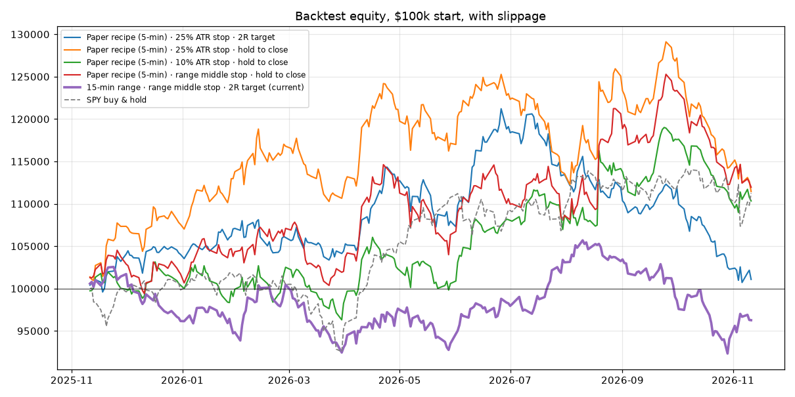

# Backtest: 2025-11-11 to 2026-11-11 (252 trading days)

- Universe: the bot's core list (110 symbols traded), 1-minute bars from the `sip` feed.
- Costs: 3 bps slippage per side on market fills (targets fill at their limit).
- **Train** = 2025-11-11 to 2026-07-15 (168 days). **Test** = 2026-07-16 to 2026-11-11 (84 days). Rule sets are ranked on train only; test is the honest check.
- Portfolio = the bot's real limits (0.5% risk/trade, 5 positions, 3 per side, 20%/position, 150% gross, one per group per side), starting at $100k. SPY buy & hold over the whole period: +11.3%.
- R = profit divided by the trade's initial risk (entry to stop). +0.10R/trade is a real edge; t-stat above ~2 means it's unlikely to be luck.

## Ranked by train-period Sharpe

| # | Rule set | Train Sharpe | Train return | **Test Sharpe** | **Test return** | Test avg R (net) | Test hit % | Trades/day | Avg stop distance |
|---|---|---|---|---|---|---|---|---|---|
| 1 | Paper recipe (5-min) · 25% ATR stop · 2R target | 2.03 | +18.8% | **-3.64** | **-14.9%** | -0.124 | 35% | 16.0 | 0.92% |
| 2 | Paper recipe (5-min) · 25% ATR stop · hold to close | 1.92 | +21.1% | **-1.05** | **-8.0%** | -0.059 | 32% | 16.0 | 0.92% |
| 3 | Paper recipe (5-min) · 10% ATR stop · hold to close (paper) | 1.33 | +11.5% | **-0.07** | **-1.1%** | -0.048 | 15% | 16.0 | 0.37% |
| 4 | Paper recipe (5-min) · range middle stop · hold to close | 1.30 | +12.8% | **-0.02** | **-0.8%** | -0.093 | 31% | 15.9 | 0.90% |
| 5 | Paper recipe (5-min) · range middle stop · 2R target | 1.28 | +11.4% | **0.74** | **+3.0%** | -0.072 | 38% | 15.9 | 0.90% |
| 6 | 5-min range · range middle stop · hold to close | 0.70 | +6.7% | **-0.86** | **-4.8%** | -0.052 | 30% | 39.7 | 0.74% |
| 7 | 5-min range · range middle stop · 2R target | 0.60 | +4.4% | **-0.59** | **-2.8%** | -0.055 | 37% | 39.7 | 0.74% |
| 8 | 15-min range · range middle stop · 2R target (current bot) | -0.16 | -1.7% | **-0.48** | **-2.1%** | -0.079 | 38% | 38.4 | 0.91% |
| 9 | 5-min range · 10% ATR stop · hold to close | -0.21 | -2.3% | **-1.02** | **-5.6%** | -0.090 | 17% | 39.7 | 0.38% |
| 10 | 5-min range · 25% ATR stop · hold to close | -0.35 | -4.0% | **-0.23** | **-1.5%** | -0.052 | 35% | 39.7 | 0.95% |
| 11 | Paper recipe (5-min) · 10% ATR stop · 2R target | -0.50 | -2.4% | **-1.22** | **-2.9%** | -0.150 | 35% | 16.0 | 0.37% |
| 12 | 15-min range · 25% ATR stop · hold to close | -1.19 | -10.5% | **-0.63** | **-3.0%** | -0.068 | 36% | 38.4 | 0.93% |
| 13 | 15-min range · range middle stop · hold to close | -1.19 | -9.8% | **-1.13** | **-4.8%** | -0.097 | 35% | 38.4 | 0.91% |
| 14 | 5-min range · 25% ATR stop · 2R target | -1.65 | -13.0% | **-1.64** | **-6.9%** | -0.071 | 37% | 39.7 | 0.95% |
| 15 | 15-min range · 25% ATR stop · 2R target | -1.71 | -12.4% | **-0.96** | **-4.0%** | -0.087 | 38% | 38.4 | 0.93% |
| 16 | 15-min range · 10% ATR stop · hold to close | -1.88 | -15.6% | **-2.84** | **-11.2%** | -0.169 | 19% | 38.4 | 0.37% |
| 17 | 5-min range · 10% ATR stop · 2R target | -2.54 | -12.6% | **-4.39** | **-11.3%** | -0.126 | 35% | 39.7 | 0.38% |
| 18 | 15-min range · 10% ATR stop · 2R target | -4.52 | -24.2% | **-5.80** | **-14.3%** | -0.170 | 34% | 38.4 | 0.37% |

## How trades ended (whole period)

| Rule set | Trades | Avg R gross | Avg R net | t-stat (net) | Hit stop | Hit target | Held to close | Max drawdown |
|---|---|---|---|---|---|---|---|---|
| Paper recipe (5-min) · 25% ATR stop · 2R target | 4025 | +0.022 | -0.051 | -2.39 | 59% | 28% | 13% | -16.9% |
| Paper recipe (5-min) · 25% ATR stop · hold to close | 4025 | +0.066 | -0.019 | -0.62 | 62% | 0% | 38% | -13.7% |
| Paper recipe (5-min) · 10% ATR stop · hold to close | 4025 | +0.187 | -0.026 | -0.45 | 83% | 0% | 17% | -8.4% |
| Paper recipe (5-min) · range middle stop · hold to close | 4005 | +0.082 | -0.034 | -1.08 | 65% | 0% | 35% | -10.6% |
| Paper recipe (5-min) · range middle stop · 2R target | 4005 | +0.056 | -0.043 | -1.96 | 59% | 29% | 12% | -6.2% |
| 5-min range · range middle stop · hold to close | 9998 | +0.090 | -0.024 | -1.19 | 66% | 0% | 34% | -12.7% |
| 5-min range · range middle stop · 2R target | 9998 | +0.070 | -0.026 | -1.88 | 59% | 31% | 10% | -8.7% |
| 15-min range · range middle stop · 2R target | 9679 | +0.026 | -0.053 | -4.14 | 52% | 23% | 25% | -12.6% |
| 5-min range · 10% ATR stop · hold to close | 9998 | +0.166 | -0.032 | -1.08 | 81% | 0% | 19% | -17.8% |
| 5-min range · 25% ATR stop · hold to close | 9998 | +0.059 | -0.020 | -1.25 | 58% | 0% | 42% | -16.3% |
| Paper recipe (5-min) · 10% ATR stop · 2R target | 4025 | +0.065 | -0.112 | -4.75 | 64% | 35% | 0% | -9.0% |
| 15-min range · 25% ATR stop · hold to close | 9679 | +0.030 | -0.051 | -3.36 | 53% | 0% | 47% | -18.2% |
| 15-min range · range middle stop · hold to close | 9679 | +0.017 | -0.074 | -4.69 | 55% | 0% | 45% | -19.6% |
| 5-min range · 25% ATR stop · 2R target | 9998 | +0.033 | -0.037 | -2.78 | 56% | 26% | 19% | -21.0% |
| 15-min range · 25% ATR stop · 2R target | 9679 | +0.017 | -0.055 | -4.34 | 52% | 22% | 26% | -18.3% |
| 15-min range · 10% ATR stop · hold to close | 9679 | +0.060 | -0.143 | -5.16 | 80% | 0% | 20% | -28.6% |
| 5-min range · 10% ATR stop · 2R target | 9998 | +0.078 | -0.086 | -5.75 | 64% | 36% | 0% | -23.5% |
| 15-min range · 10% ATR stop · 2R target | 9679 | +0.022 | -0.147 | -9.85 | 65% | 34% | 1% | -36.6% |

Limits: core list only (no historical top-mover lists), 1-minute bars, no dynamic correlation guard or daily loss limit. Files: `results.csv`, `trades.csv.gz`.
