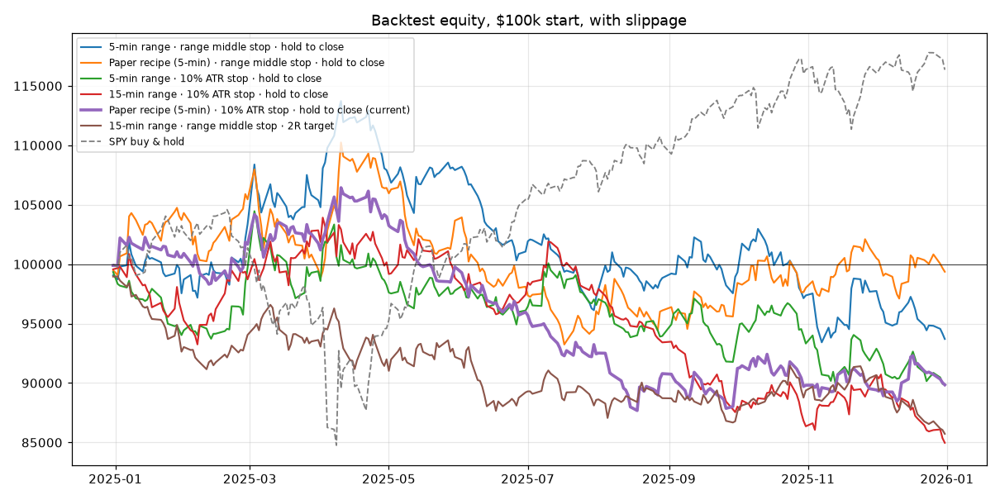

# Backtest: 2016-12-29 to 2017-12-29 (253 trading days)

- Universe: the bot's core list (87 symbols traded), 1-minute bars from the `sip` feed.
- Costs: 3 bps slippage per side on market fills (targets fill at their limit).
- **Train** = 2016-12-29 to 2017-08-29 (168 days). **Test** = 2017-08-30 to 2017-12-29 (85 days). Rule sets are ranked on train only; test is the honest check.
- Portfolio = the bot's real limits (0.5% risk/trade, 5 positions, 3 per side, 20%/position, 150% gross, one per group per side), starting at $100k. SPY buy & hold over the whole period: +18.9%.
- R = profit divided by the trade's initial risk (entry to stop). +0.10R/trade is a real edge; t-stat above ~2 means it's unlikely to be luck.

## Ranked by train-period Sharpe

| # | Rule set | Train Sharpe | Train return | **Test Sharpe** | **Test return** | Test avg R (net) | Test hit % | Trades/day | Avg stop distance |
|---|---|---|---|---|---|---|---|---|---|
| 1 | Paper recipe (5-min) · 25% ATR stop · hold to close | -0.01 | -0.2% | **1.04** | **+2.6%** | -0.011 | 32% | 11.7 | 0.41% |
| 2 | Paper recipe (5-min) · 25% ATR stop · 2R target | -0.44 | -1.7% | **0.96** | **+1.6%** | -0.034 | 39% | 11.7 | 0.41% |
| 3 | 5-min range · 25% ATR stop · 2R target | -0.54 | -2.2% | **-5.02** | **-8.7%** | -0.073 | 38% | 39.7 | 0.44% |
| 4 | 5-min range · 25% ATR stop · hold to close | -0.76 | -3.9% | **-2.56** | **-6.4%** | -0.031 | 34% | 39.7 | 0.44% |
| 5 | Paper recipe (5-min) · 10% ATR stop · hold to close (current bot = paper recipe) | -1.29 | -4.8% | **0.48** | **+0.9%** | +0.035 | 18% | 11.6 | 0.17% |
| 6 | Paper recipe (5-min) · range middle stop · hold to close | -1.37 | -6.4% | **0.29** | **+0.6%** | -0.100 | 28% | 11.3 | 0.37% |
| 7 | Paper recipe (5-min) · range middle stop · 2R target | -1.94 | -6.8% | **1.96** | **+4.1%** | -0.040 | 40% | 11.3 | 0.37% |
| 8 | 5-min range · range middle stop · hold to close | -2.35 | -12.0% | **-2.89** | **-7.8%** | -0.056 | 26% | 39.7 | 0.32% |
| 9 | 15-min range · 25% ATR stop · hold to close | -2.67 | -12.5% | **-0.46** | **-1.2%** | -0.094 | 34% | 38.6 | 0.44% |
| 10 | Paper recipe (5-min) · 10% ATR stop · 2R target | -3.50 | -6.4% | **-3.34** | **-3.6%** | -0.161 | 40% | 11.6 | 0.17% |
| 11 | 5-min range · 10% ATR stop · hold to close | -3.87 | -16.5% | **-2.61** | **-6.6%** | -0.053 | 18% | 39.7 | 0.18% |
| 12 | 15-min range · 25% ATR stop · 2R target | -3.88 | -13.4% | **-1.58** | **-3.2%** | -0.118 | 37% | 38.6 | 0.44% |
| 13 | 5-min range · range middle stop · 2R target | -3.98 | -15.8% | **-2.80** | **-6.1%** | -0.129 | 37% | 39.7 | 0.32% |
| 14 | 15-min range · range middle stop · hold to close | -3.99 | -16.2% | **-0.85** | **-2.0%** | -0.125 | 33% | 38.6 | 0.43% |
| 15 | 15-min range · range middle stop · 2R target (old v2 rules) | -4.50 | -16.4% | **-1.57** | **-3.6%** | -0.144 | 37% | 38.6 | 0.43% |
| 16 | 15-min range · 10% ATR stop · hold to close | -6.20 | -23.1% | **-4.64** | **-10.6%** | -0.202 | 18% | 38.5 | 0.18% |
| 17 | 5-min range · 10% ATR stop · 2R target | -10.23 | -21.6% | **-9.06** | **-12.2%** | -0.208 | 37% | 39.7 | 0.18% |
| 18 | 15-min range · 10% ATR stop · 2R target | -11.04 | -25.3% | **-8.83** | **-12.8%** | -0.294 | 35% | 38.5 | 0.18% |

## How trades ended (whole period)

| Rule set | Trades | Avg R gross | Avg R net | t-stat (net) | Hit stop | Hit target | Held to close | Max drawdown |
|---|---|---|---|---|---|---|---|---|
| Paper recipe (5-min) · 25% ATR stop · hold to close | 2971 | +0.137 | -0.045 | -1.28 | 60% | 0% | 40% | -6.9% |
| Paper recipe (5-min) · 25% ATR stop · 2R target | 2971 | +0.109 | -0.045 | -1.75 | 56% | 31% | 14% | -5.2% |
| 5-min range · 25% ATR stop · 2R target | 10046 | +0.046 | -0.092 | -6.85 | 56% | 27% | 17% | -12.6% |
| 5-min range · 25% ATR stop · hold to close | 10046 | +0.067 | -0.093 | -5.32 | 59% | 0% | 41% | -12.7% |
| Paper recipe (5-min) · 10% ATR stop · hold to close | 2936 | +0.365 | -0.078 | -1.16 | 81% | 0% | 19% | -7.7% |
| Paper recipe (5-min) · range middle stop · hold to close | 2866 | +0.151 | -0.119 | -2.86 | 67% | 0% | 33% | -10.5% |
| Paper recipe (5-min) · range middle stop · 2R target | 2866 | +0.134 | -0.087 | -3.16 | 58% | 34% | 9% | -10.3% |
| 5-min range · range middle stop · hold to close | 10046 | +0.092 | -0.157 | -6.78 | 70% | 0% | 30% | -20.8% |
| 15-min range · 25% ATR stop · hold to close | 9767 | +0.034 | -0.129 | -7.82 | 56% | 0% | 44% | -14.8% |
| Paper recipe (5-min) · 10% ATR stop · 2R target | 2936 | +0.183 | -0.173 | -5.93 | 60% | 39% | 0% | -9.8% |
| 5-min range · 10% ATR stop · hold to close | 10038 | +0.164 | -0.235 | -7.35 | 82% | 0% | 18% | -22.1% |
| 15-min range · 25% ATR stop · 2R target | 9767 | +0.011 | -0.133 | -10.13 | 54% | 23% | 23% | -16.3% |
| 5-min range · range middle stop · 2R target | 10046 | +0.061 | -0.146 | -10.05 | 61% | 32% | 7% | -21.3% |
| 15-min range · range middle stop · hold to close | 9767 | +0.034 | -0.159 | -8.86 | 59% | 0% | 41% | -19.2% |
| 15-min range · range middle stop · 2R target | 9767 | +0.010 | -0.157 | -11.64 | 56% | 25% | 19% | -20.3% |
| 15-min range · 10% ATR stop · hold to close | 9743 | +0.075 | -0.330 | -10.93 | 82% | 0% | 18% | -31.3% |
| 5-min range · 10% ATR stop · 2R target | 10038 | +0.083 | -0.245 | -15.82 | 64% | 36% | 0% | -31.2% |
| 15-min range · 10% ATR stop · 2R target | 9743 | +0.019 | -0.318 | -20.58 | 66% | 34% | 1% | -34.8% |

Limits: core list only (no historical top-mover lists), 1-minute bars, no dynamic correlation guard or daily loss limit. Files: `results.csv`, `trades.csv.gz`.
