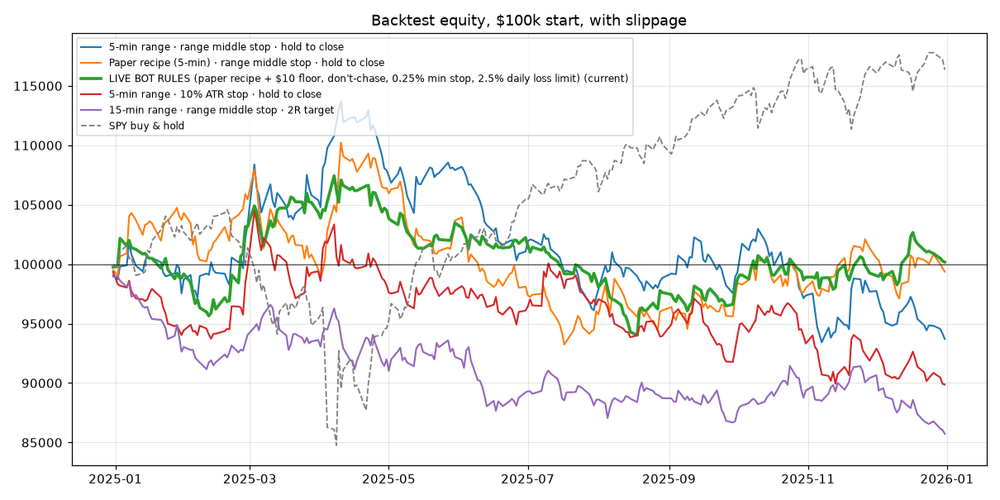

# Backtest: 2024-12-31 to 2025-12-31 (251 trading days)

- Universe: the bot's core list (111 symbols traded), 1-minute bars from the `sip` feed.
- Costs: 3 bps slippage per side on market fills (targets fill at their limit).
- **Train** = 2024-12-31 to 2025-09-02 (167 days). **Test** = 2025-09-03 to 2025-12-31 (84 days). Rule sets are ranked on train only; test is the honest check.
- Portfolio = the bot's real limits (0.5% risk/trade, 5 positions, 3 per side, 20%/position, 150% gross, one per group per side), starting at $100k. SPY buy & hold over the whole period: +16.4%.
- R = profit divided by the trade's initial risk (entry to stop). +0.10R/trade is a real edge; t-stat above ~2 means it's unlikely to be luck.

## Ranked by train-period Sharpe

| # | Rule set | Train Sharpe | Train return | **Test Sharpe** | **Test return** | Test avg R (net) | Test hit % | Trades/day | Avg stop distance |
|---|---|---|---|---|---|---|---|---|---|
| 1 | 5-min range · range middle stop · hold to close | -0.00 | -0.8% | **-1.19** | **-5.5%** | -0.107 | 27% | 39.7 | 0.64% |
| 2 | Paper recipe (5-min) · range middle stop · hold to close | -0.27 | -3.6% | **0.77** | **+3.0%** | -0.100 | 28% | 15.4 | 0.77% |
| 3 | LIVE BOT RULES (paper recipe + $10 floor, don't-chase, 0.25% min stop, 2.5% daily loss limit) (current bot) | -0.27 | -2.5% | **0.88** | **+2.8%** | +0.121 | 17% | 8.9 | 0.43% |
| 4 | 5-min range · 10% ATR stop · hold to close | -0.49 | -5.1% | **-1.28** | **-5.3%** | -0.168 | 16% | 39.7 | 0.35% |
| 5 | 15-min range · 10% ATR stop · hold to close | -0.70 | -6.5% | **-2.47** | **-9.1%** | -0.181 | 18% | 38.6 | 0.35% |
| 6 | 5-min range · range middle stop · 2R target | -0.74 | -5.9% | **-0.82** | **-2.7%** | -0.094 | 35% | 39.7 | 0.64% |
| 7 | 5-min range · 25% ATR stop · hold to close | -0.79 | -7.6% | **-0.37** | **-2.1%** | -0.056 | 34% | 39.7 | 0.86% |
| 8 | 15-min range · range middle stop · hold to close | -0.83 | -7.6% | **-1.75** | **-6.9%** | -0.128 | 33% | 38.6 | 0.80% |
| 9 | 15-min range · 25% ATR stop · hold to close | -1.00 | -9.2% | **-2.10** | **-9.5%** | -0.101 | 35% | 38.6 | 0.87% |
| 10 | 15-min range · 25% ATR stop · 2R target | -1.08 | -8.4% | **-2.73** | **-10.3%** | -0.090 | 37% | 38.6 | 0.87% |
| 11 | Paper recipe (5-min) · 10% ATR stop · hold to close (paper recipe, no filters) | -1.15 | -9.3% | **-0.22** | **-1.0%** | -0.143 | 15% | 15.5 | 0.33% |
| 12 | 5-min range · 25% ATR stop · 2R target | -1.30 | -10.1% | **-2.42** | **-8.4%** | -0.061 | 37% | 39.7 | 0.86% |
| 13 | 15-min range · range middle stop · 2R target (old v2 rules) | -1.56 | -11.3% | **-1.01** | **-3.4%** | -0.092 | 37% | 38.6 | 0.80% |
| 14 | Paper recipe (5-min) · range middle stop · 2R target | -1.66 | -12.5% | **-1.73** | **-5.3%** | -0.102 | 36% | 15.4 | 0.77% |
| 15 | 5-min range · 10% ATR stop · 2R target | -1.75 | -8.9% | **-3.78** | **-8.5%** | -0.129 | 35% | 39.7 | 0.35% |
| 16 | Paper recipe (5-min) · 25% ATR stop · hold to close | -1.77 | -16.0% | **1.58** | **+7.6%** | -0.015 | 31% | 15.5 | 0.81% |
| 17 | Paper recipe (5-min) · 10% ATR stop · 2R target | -1.83 | -7.6% | **-1.14** | **-2.0%** | -0.117 | 37% | 15.5 | 0.33% |
| 18 | 15-min range · 10% ATR stop · 2R target | -1.92 | -10.3% | **-5.21** | **-11.7%** | -0.141 | 35% | 38.6 | 0.35% |
| 19 | Paper recipe (5-min) · 25% ATR stop · 2R target | -2.88 | -19.9% | **0.44** | **+1.3%** | -0.065 | 36% | 15.5 | 0.81% |

## How trades ended (whole period)

| Rule set | Trades | Avg R gross | Avg R net | t-stat (net) | Hit stop | Hit target | Held to close | Max drawdown |
|---|---|---|---|---|---|---|---|---|
| 5-min range · range middle stop · hold to close | 9958 | +0.076 | -0.054 | -2.54 | 69% | 0% | 31% | -17.8% |
| Paper recipe (5-min) · range middle stop · hold to close | 3868 | +0.095 | -0.044 | -1.27 | 67% | 0% | 33% | -15.4% |
| LIVE BOT RULES (paper recipe + $10 floor, don't-chase, 0.25% min stop, 2.5% daily loss limit) | 2238 | +0.197 | +0.040 | 0.59 | 82% | 0% | 18% | -12.5% |
| 5-min range · 10% ATR stop · hold to close | 9958 | +0.131 | -0.086 | -2.87 | 81% | 0% | 19% | -14.0% |
| 15-min range · 10% ATR stop · hold to close | 9688 | +0.157 | -0.062 | -2.09 | 79% | 0% | 21% | -18.2% |
| 5-min range · range middle stop · 2R target | 9958 | +0.040 | -0.070 | -4.94 | 61% | 31% | 8% | -14.5% |
| 5-min range · 25% ATR stop · hold to close | 9958 | +0.061 | -0.026 | -1.57 | 58% | 0% | 42% | -19.9% |
| 15-min range · range middle stop · hold to close | 9688 | +0.046 | -0.058 | -3.39 | 58% | 0% | 42% | -15.2% |
| 15-min range · 25% ATR stop · hold to close | 9688 | +0.051 | -0.037 | -2.33 | 54% | 0% | 46% | -19.9% |
| 15-min range · 25% ATR stop · 2R target | 9688 | +0.043 | -0.035 | -2.69 | 52% | 23% | 26% | -18.7% |
| Paper recipe (5-min) · 10% ATR stop · hold to close | 3888 | +0.153 | -0.087 | -1.66 | 83% | 0% | 17% | -17.6% |
| 5-min range · 25% ATR stop · 2R target | 9958 | +0.033 | -0.043 | -3.25 | 55% | 25% | 20% | -20.4% |
| 15-min range · range middle stop · 2R target | 9688 | +0.037 | -0.052 | -3.91 | 54% | 25% | 20% | -14.3% |
| Paper recipe (5-min) · range middle stop · 2R target | 3868 | +0.033 | -0.084 | -3.77 | 60% | 29% | 11% | -21.2% |
| 5-min range · 10% ATR stop · 2R target | 9958 | +0.085 | -0.093 | -6.21 | 64% | 36% | 0% | -17.3% |
| Paper recipe (5-min) · 25% ATR stop · hold to close | 3888 | +0.071 | -0.025 | -0.85 | 63% | 0% | 37% | -19.3% |
| Paper recipe (5-min) · 10% ATR stop · 2R target | 3888 | +0.098 | -0.099 | -4.08 | 63% | 36% | 0% | -13.2% |
| 15-min range · 10% ATR stop · 2R target | 9688 | +0.073 | -0.107 | -7.06 | 64% | 35% | 1% | -21.0% |
| Paper recipe (5-min) · 25% ATR stop · 2R target | 3888 | +0.023 | -0.060 | -2.74 | 59% | 28% | 13% | -24.1% |

Limits: core list only (no historical top-mover lists), 1-minute bars, no dynamic correlation guard or daily loss limit. Files: `results.csv`, `trades.csv.gz`.
