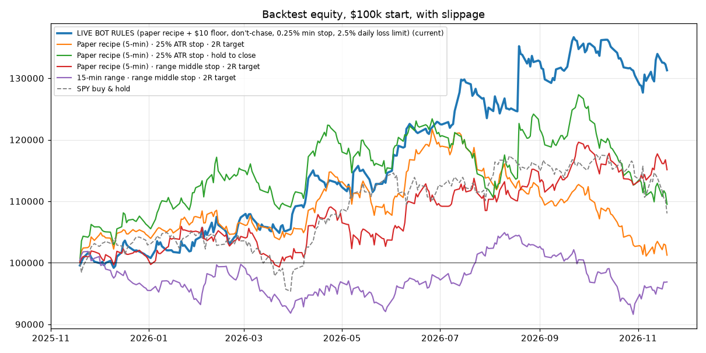

# Backtest: 2025-11-19 to 2026-11-19 (252 trading days)

- Universe: the bot's core list (110 symbols traded), 1-minute bars from the `sip` feed.
- Costs: 3 bps slippage per side on market fills (targets fill at their limit).
- **Train** = 2025-11-19 to 2026-07-23 (168 days). **Test** = 2026-07-24 to 2026-11-19 (84 days). Rule sets are ranked on train only; test is the honest check.
- Portfolio = the bot's real limits (0.5% risk/trade, 5 positions, 3 per side, 20%/position, 150% gross, one per group per side), starting at $100k. SPY buy & hold over the whole period: +8.0%.
- R = profit divided by the trade's initial risk (entry to stop). +0.10R/trade is a real edge; t-stat above ~2 means it's unlikely to be luck.

## Ranked by train-period Sharpe

| # | Rule set | Train Sharpe | Train return | **Test Sharpe** | **Test return** | Test avg R (net) | Test hit % | Trades/day | Avg stop distance |
|---|---|---|---|---|---|---|---|---|---|
| 1 | LIVE BOT RULES (paper recipe + $10 floor, don't-chase, 0.25% min stop, 2.5% daily loss limit) (current bot) | 2.78 | +28.3% | **0.44** | **+2.4%** | +0.107 | 17% | 11.1 | 0.45% |
| 2 | Paper recipe (5-min) · 25% ATR stop · 2R target | 1.83 | +17.1% | **-3.19** | **-13.5%** | -0.109 | 36% | 16.0 | 0.93% |
| 3 | Paper recipe (5-min) · 25% ATR stop · hold to close | 1.51 | +16.0% | **-0.68** | **-5.7%** | -0.049 | 32% | 16.0 | 0.93% |
| 4 | Paper recipe (5-min) · range middle stop · 2R target | 1.38 | +12.6% | **0.55** | **+2.2%** | -0.056 | 38% | 15.9 | 0.90% |
| 5 | Paper recipe (5-min) · range middle stop · hold to close | 1.17 | +11.4% | **-0.05** | **-1.0%** | -0.092 | 30% | 15.9 | 0.90% |
| 6 | Paper recipe (5-min) · 10% ATR stop · hold to close (paper recipe, no filters) | 1.11 | +9.5% | **0.14** | **+0.3%** | -0.019 | 16% | 16.0 | 0.37% |
| 7 | 5-min range · range middle stop · hold to close | 0.57 | +5.3% | **-0.47** | **-2.9%** | -0.048 | 30% | 39.7 | 0.74% |
| 8 | 5-min range · range middle stop · 2R target | 0.28 | +1.8% | **-0.71** | **-3.1%** | -0.048 | 37% | 39.7 | 0.74% |
| 9 | 15-min range · range middle stop · 2R target (old v2 rules) | 0.07 | +0.1% | **-0.76** | **-3.2%** | -0.077 | 38% | 38.4 | 0.91% |
| 10 | 5-min range · 10% ATR stop · hold to close | -0.36 | -3.7% | **-1.10** | **-5.8%** | -0.066 | 18% | 39.7 | 0.38% |
| 11 | 5-min range · 25% ATR stop · hold to close | -0.56 | -5.9% | **0.30** | **+1.1%** | -0.038 | 36% | 39.7 | 0.95% |
| 12 | Paper recipe (5-min) · 10% ATR stop · 2R target | -0.92 | -4.3% | **-0.32** | **-0.9%** | -0.112 | 36% | 16.0 | 0.37% |
| 13 | 15-min range · range middle stop · hold to close | -0.96 | -8.1% | **-1.42** | **-6.0%** | -0.090 | 35% | 38.4 | 0.91% |
| 14 | 15-min range · 25% ATR stop · hold to close | -1.34 | -11.7% | **-0.47** | **-2.5%** | -0.067 | 36% | 38.4 | 0.94% |
| 15 | 5-min range · 25% ATR stop · 2R target | -1.58 | -12.5% | **-0.95** | **-4.1%** | -0.057 | 38% | 39.7 | 0.95% |
| 16 | 15-min range · 25% ATR stop · 2R target | -1.71 | -12.3% | **-1.23** | **-5.2%** | -0.092 | 38% | 38.4 | 0.94% |
| 17 | 15-min range · 10% ATR stop · hold to close | -1.87 | -15.5% | **-2.73** | **-11.4%** | -0.165 | 18% | 38.4 | 0.38% |
| 18 | 5-min range · 10% ATR stop · 2R target | -2.62 | -13.3% | **-4.33** | **-10.7%** | -0.111 | 35% | 39.7 | 0.38% |
| 19 | 15-min range · 10% ATR stop · 2R target | -4.86 | -25.7% | **-5.48** | **-14.1%** | -0.172 | 33% | 38.4 | 0.38% |

## How trades ended (whole period)

| Rule set | Trades | Avg R gross | Avg R net | t-stat (net) | Hit stop | Hit target | Held to close | Max drawdown |
|---|---|---|---|---|---|---|---|---|
| LIVE BOT RULES (paper recipe + $10 floor, don't-chase, 0.25% min stop, 2.5% daily loss limit) | 2788 | +0.256 | +0.105 | 1.42 | 81% | 0% | 19% | -6.6% |
| Paper recipe (5-min) · 25% ATR stop · 2R target | 4021 | +0.021 | -0.053 | -2.46 | 59% | 28% | 13% | -16.9% |
| Paper recipe (5-min) · 25% ATR stop · hold to close | 4021 | +0.064 | -0.021 | -0.70 | 62% | 0% | 38% | -14.0% |
| Paper recipe (5-min) · range middle stop · 2R target | 4001 | +0.053 | -0.046 | -2.10 | 59% | 29% | 12% | -6.2% |
| Paper recipe (5-min) · range middle stop · hold to close | 4001 | +0.074 | -0.043 | -1.35 | 65% | 0% | 35% | -10.6% |
| Paper recipe (5-min) · 10% ATR stop · hold to close | 4021 | +0.186 | -0.025 | -0.43 | 83% | 0% | 17% | -8.5% |
| 5-min range · range middle stop · hold to close | 10000 | +0.076 | -0.038 | -1.90 | 66% | 0% | 34% | -12.7% |
| 5-min range · range middle stop · 2R target | 10000 | +0.063 | -0.033 | -2.39 | 60% | 31% | 10% | -8.7% |
| 15-min range · range middle stop · 2R target | 9673 | +0.023 | -0.057 | -4.38 | 52% | 23% | 25% | -12.7% |
| 5-min range · 10% ATR stop · hold to close | 10000 | +0.153 | -0.045 | -1.50 | 81% | 0% | 19% | -17.7% |
| 5-min range · 25% ATR stop · hold to close | 10000 | +0.052 | -0.027 | -1.68 | 58% | 0% | 42% | -16.4% |
| Paper recipe (5-min) · 10% ATR stop · 2R target | 4021 | +0.066 | -0.110 | -4.65 | 64% | 35% | 0% | -9.0% |
| 15-min range · range middle stop · hold to close | 9673 | +0.016 | -0.075 | -4.76 | 55% | 0% | 45% | -19.7% |
| 15-min range · 25% ATR stop · hold to close | 9673 | +0.027 | -0.054 | -3.57 | 54% | 0% | 46% | -19.1% |
| 5-min range · 25% ATR stop · 2R target | 10000 | +0.028 | -0.041 | -3.14 | 56% | 25% | 19% | -21.0% |
| 15-min range · 25% ATR stop · 2R target | 9673 | +0.012 | -0.060 | -4.71 | 52% | 21% | 26% | -18.6% |
| 15-min range · 10% ATR stop · hold to close | 9673 | +0.054 | -0.149 | -5.37 | 80% | 0% | 20% | -29.1% |
| 5-min range · 10% ATR stop · 2R target | 10000 | +0.076 | -0.087 | -5.83 | 64% | 36% | 0% | -23.3% |
| 15-min range · 10% ATR stop · 2R target | 9673 | +0.014 | -0.154 | -10.35 | 66% | 33% | 1% | -36.5% |

Limits: core list only (no historical top-mover lists), 1-minute bars, no dynamic correlation guard or daily loss limit. Files: `results.csv`, `trades.csv.gz`.
